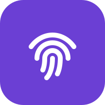
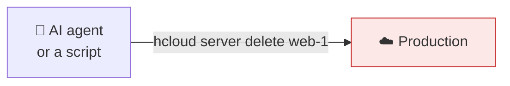
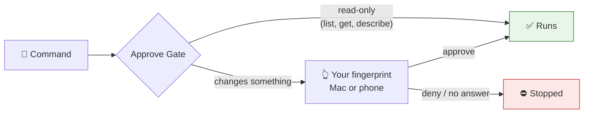
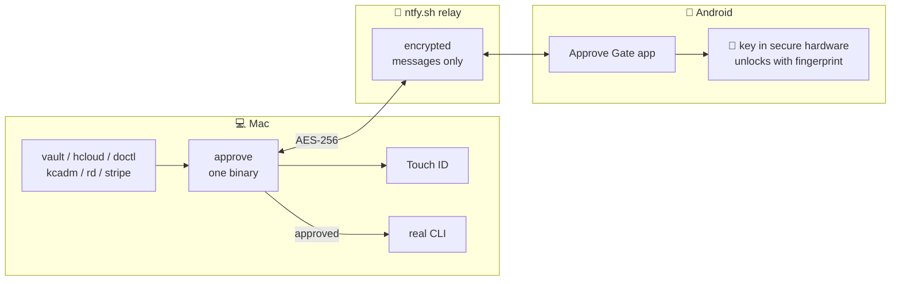
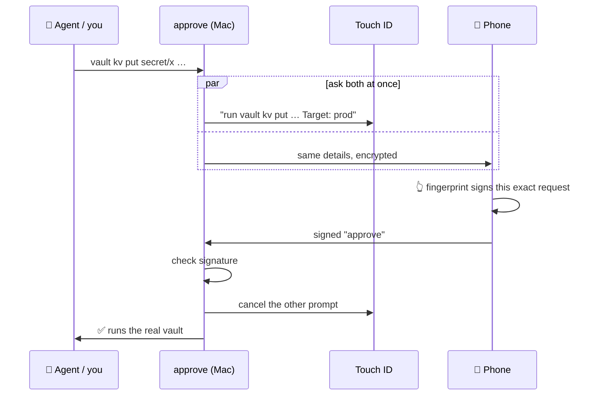
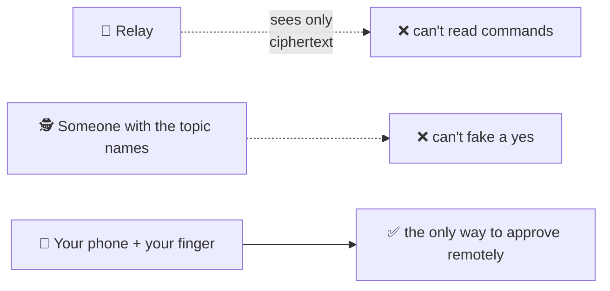
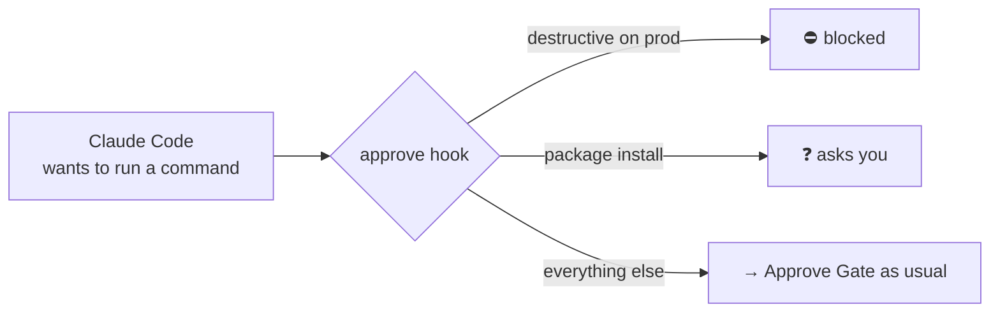

<p align="center"></p>

<h1 align="center">Approve Gate</h1>

**Your fingerprint, on every risky command.** Touch ID on your Mac, or the fingerprint sensor on
your Android phone, whichever is closer. Every prompt shows exactly what you are approving.

```
$ vault kv put secret/payments key=…
  → 🔒 Approve on Mac or phone?   vault kv put secret/payments …   Target: PRODUCTION
  ✓ Approved on phone
```

---

## 1. The problem

AI coding agents (and scripts, and tired humans) run commands on your machine. Most are harmless.
A few can delete a server, rotate a secret, or charge a card.



The usual fixes don't fit:

| Fix | Why it falls short |
|---|---|
| Ask "Allow?" in chat | You click yes 800 times a day and stop reading |
| `sudo` password prompt | Doesn't say what you're approving; useless when you're away from the keyboard |
| Block everything | The agent can't do its job |

## 2. The idea

Let the safe calls through. Stop the risky ones and ask **you**, with your fingerprint, showing the
**exact command and where it runs**. Answer from the Mac, or from your phone when you're away.



## 3. How it works

One small program on the Mac (`approve`), one app on the phone, and a relay in between that only
ever sees encrypted messages.



The CLI names are just links to `approve`. When you type `vault …`, `approve` decides whether to
ask, asks, and only then runs the real `vault`.

### One approval, step by step



First answer wins. Deny, or no answer within 90 seconds, and the command doesn't run.

## 4. Why you can trust it



- **Encrypted end to end.** The key travels once, inside the pairing QR code, never through the relay.
- **Signed by hardware.** The phone's signing key lives in its secure chip and needs a fresh
  fingerprint for every signature. A new fingerprint enrolled on the phone invalidates it.
- **One signature, one request.** Each approval covers one request id and expiry, so it can't be replayed.
- **No hidden tricks.** Invisible characters in a command show up as `\u{…}`, and a very long command
  says how much is cut off.
- **Pairing is yours.** A new pairing only starts from your terminal, and replacing a paired phone
  needs your approval first.
- **Nothing on the lock screen.** The notification shows the tool and target; the command appears after unlock.
- **Fails closed.** Relay down, phone off, no answer: the command does not run. Touch ID still works.

### What it isn't

Out of the box it's a checkpoint: it stops mistakes and keeps a well-behaved agent honest, with every
call logged. To make it a lock, use **system mode** (rules, pairing and binary owned by root) and the
**credential broker** (secrets in the Keychain, handed to the CLI only after approval).
[How, and what's left](docs/details.md#locking-it-down-system-mode-and-the-credential-broker).

## 5. Bonus: a seatbelt for Claude Code

`approve hook` plugs into Claude Code as a pre-command check. It blocks a short list of commands
outright (for example deleting servers on a production cloud account) so they never even reach the
approval step, and asks before package installs.



## 6. Get started

```bash
brew install naufalafif/tap/approve-gate
approve setup       # root-owned install, CLI links, menu bar app (asks for Touch ID once)
approve pair        # scan the QR code with the phone app
```

Update with `brew upgrade approve-gate && approve setup`. Put `~/.local/bin/touchid-wrap` first on
your `PATH`; the menu bar app warns if a CLI skips it. Install the phone app from
[Releases](../../releases) (or add this repo to [Obtainium](https://obtainium.imranr.dev) for
updates).

Which calls are free and which ask lives in the rules. Change them in the menu bar app's Settings,
or with `approve rules` (for example `approve rules add kubectl`, `approve rules disable kubectl`):

```json
"hcloud": { "default": "gated", "free": ["server list*", "server describe*", "--help", "* --help"] }
```

## 7. What's inside

| Part | Where | Job |
|---|---|---|
| `approve` | [`mac/`](mac) (Swift) | Wrapper, approval, pairing, Claude Code hook. One binary. |
| Phone app | [`android/`](android) (Kotlin) | Shows the request, signs with your fingerprint |
| Fake phone | [`tools/fakephone.swift`](tools/fakephone.swift) | Same protocol in software, for tests |
| Tests | [`tests/`](tests) | Rule and hook decisions, plus a full pair-and-approve run over the relay |

Every push runs builds, the tests, and security scans (secrets, SAST, dependencies, workflows).
Details, protocol and commands: [docs/details.md](docs/details.md).

## Limits

- macOS and Android only.
- The default relay, ntfy.sh, is a free public service. You can self-host it: `approve pair --server https://your-ntfy`.
- Some Android phones (Xiaomi, for example) delay notifications while asleep unless you allow the app to run in the background.
